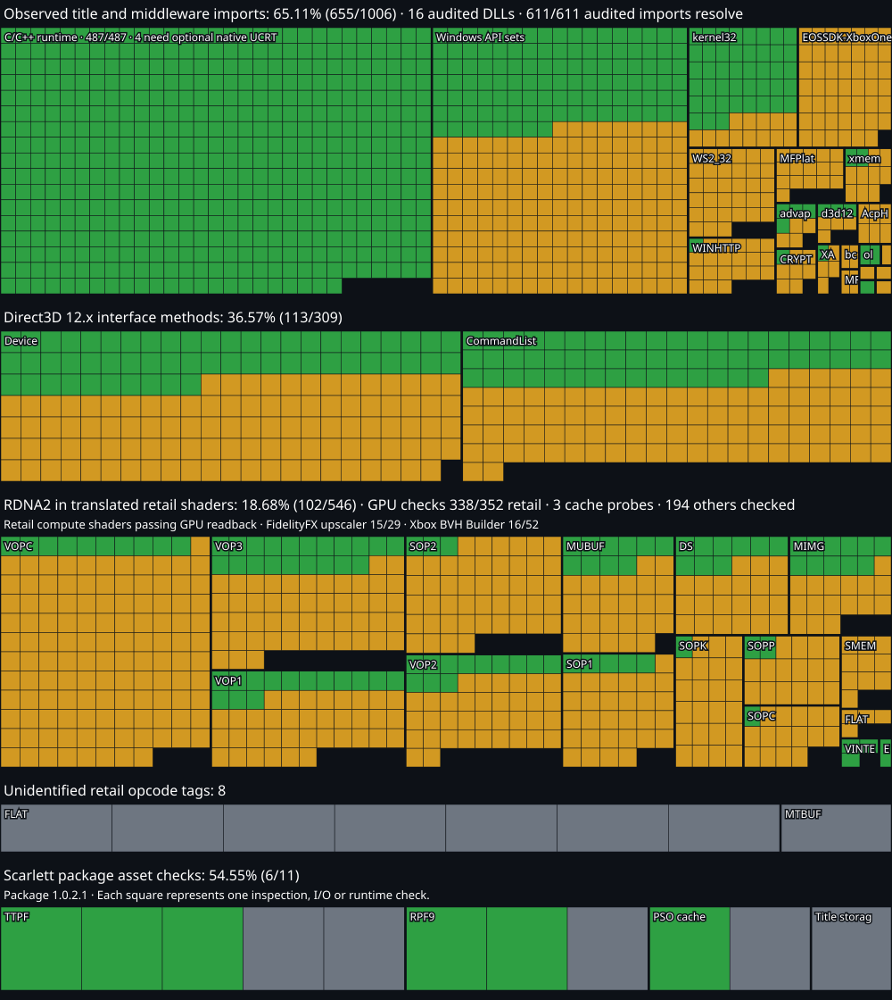

# TomBox

TomBox is an experimental Xbox Series X|S compatibility runtime for x64 Windows PCs. Game code runs directly on the host CPU. TomBox translates Xbox Direct3D 12 calls and precompiled RDNA2 shaders, mirrors console textures into PC GPU memory, and supplies the system libraries the game expects.

## Status

| Tested build | What works | Open issues |
|---|---|---|
| Fortnite Chapter 2 Season 4 · 2.0.1461.7919 · Windows | Boots, logs in to a private server and reaches the lobby. The 2D interface renders and mouse input works. | The character material and bloom render incorrectly. The lobby is silent. Gameplay and retail controller input remain unverified. |
| Coin Run · homebrew · Linux with Proton | Playable in 2D and 3D. GPU readback checks textures and depth. Virtual pads verify GameInput polling, callbacks, hotplug and rumble. Stereo loopback verifies XAudio2 pickup sounds, panning and mixing. | Controller tests use virtual devices. Physical controllers, reverb and spatial audio remain unverified. |

[](docs/COMPATIBILITY.md) [](docs/img/progress.svg) [](docs/img/progress.svg) [](docs/DEVELOPMENT_LOG.md) [](CLAUDE.md#12-milestones-and-definition-of-success)

[](docs/img/progress.svg)

**Reading the map.** Green counts a covered item, amber marks partial support or an unverified binding, and grey marks an unmapped or unobserved item. Each section measures something different.

- **System imports** count the tested Fortnite build’s imports, including native Windows functions. Coin Run independently verifies the ordinal-1 factories for GameInput and XAudio2.
- **Direct3D 12.x** counts covered device and command-list slots once across GXDK editions. A discovery beyond the tracked range extends the denominator. [Slot evidence](docs/COMPATIBILITY.md#d3d12x-slot-tracking)
- **RDNA2** tracks named instructions across Fortnite and Xbox BVH Builder. Green means every scanned retail shader using the instruction translated. Partial retail translation and GPU-only checks earn amber. Hover over a square for counts by source.
- **Retail milestones** track the path from inspecting a dump through playable games. One retail title has been tested. Its latest completed milestone is reaching the main menu. [Compatibility matrix](docs/COMPATIBILITY.md) · [Known limitations](docs/TECHNICAL_DEBT.md)

## Try Coin Run on Linux

Coin Run uses generated game assets and runs without a console or retail dump. Install the Rust `x86_64-pc-windows-msvc` target, cargo-xwin, Python 3, clang-cl and lld-link. From the repository root, point `PROTON` at your Proton Experimental executable.

```sh
export PROTON="/path/to/Proton - Experimental/proton"
tools/homebrew/build-clear.sh
tools/homebrew/play-coins.sh --3d
```

Collect both coins with WASD, the D-pad or the left stick. R or Menu restarts the board. Q or Escape quits. Run `tools/homebrew/play-coins.sh --rdna2-test` for shader verification. Use `--3d-test`, `--gameinput-test` or `--audio-test` for individual gameplay checks. [Test dependencies, commands and reference fixtures](tools/homebrew/README.md)

## Build on Windows

The runtime targets Windows 10/11 x64 with a Direct3D 12 GPU, Microsoft Gaming Services, Rust and the Windows SDK. The title guide covers the static CRT build, DLL placement, drive mapping, configuration and logs. [Windows build and launch guide](docs/RUNNING.md)

## Research and scope

The development log records retail test results. The Linux research tools work with the included fixtures. [Development log](docs/DEVELOPMENT_LOG.md) · [Linux research tools](tools/homebrew/README.md#linux-research-tools) · [Architecture](docs/ARCHITECTURE.md) · [Design decisions](docs/DECISIONS.md) · [Xbox platform research](docs/XBOX_RESEARCH.md) · [Fortnite analysis](docs/FORTNITE_ANALYSIS.md) · [Progress data and generator](tools/progress/)

TomBox is independent interoperability research for authorised, already-decrypted binaries. Bring your own game files. Package decryption, key extraction, console-security bypasses and anti-cheat changes are outside the project’s scope. Network access defaults to offline. Project testing uses local substitutes or a private server. The local user and store provide no Xbox Live account or entitlements. Xbox is a Microsoft trademark. TomBox is unaffiliated with Microsoft and game publishers.
